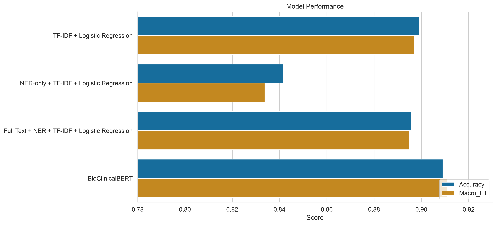
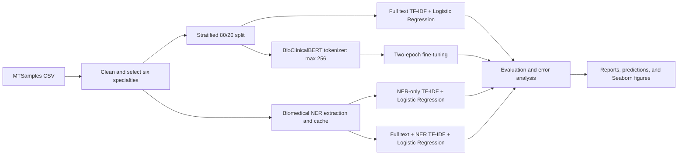
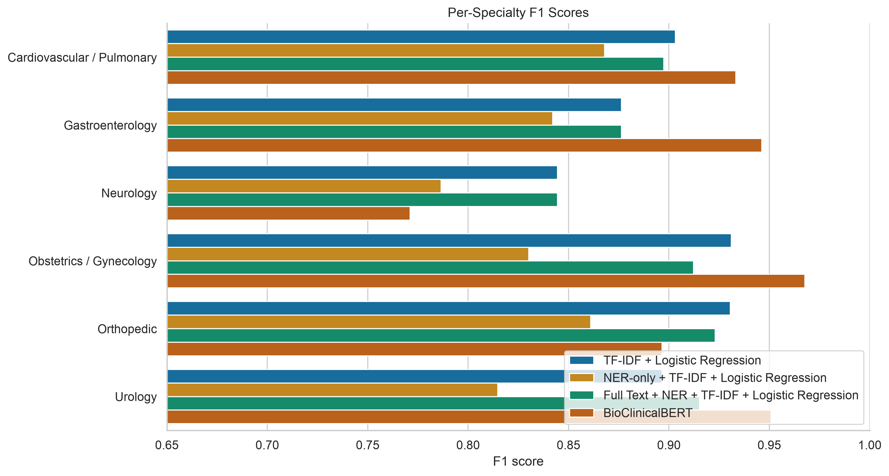
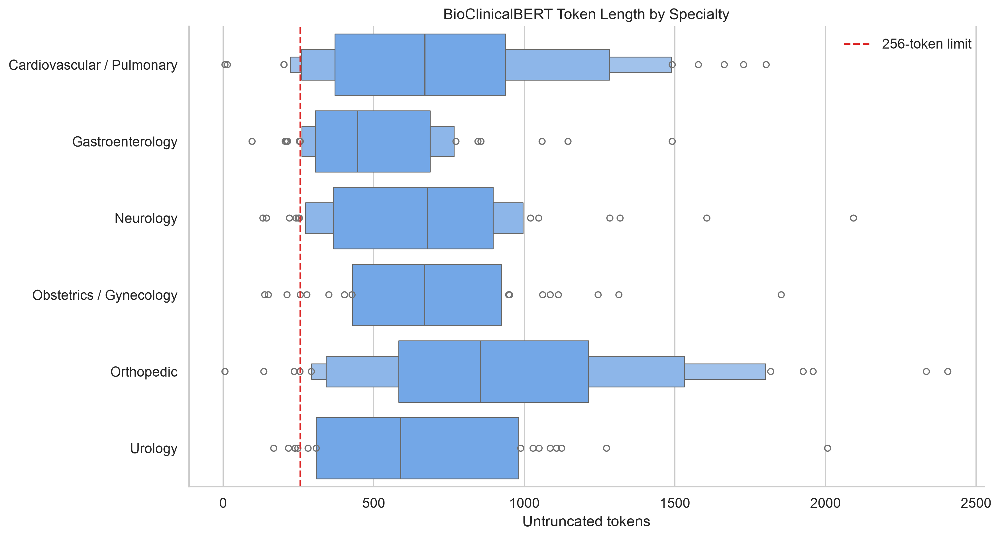

# Clinical NLP Specialty Classification

[](https://www.python.org/)
[](https://scikit-learn.org/)
[](https://huggingface.co/emilyalsentzer/Bio_ClinicalBERT)

An end-to-end, reproducible clinical NLP project that classifies medical transcriptions into six specialties. It compares three TF-IDF ablations with fine-tuned BioClinicalBERT and includes data preparation, resumable biomedical NER, model training, evaluation, error analysis, visualization, and inference code.

> This is a research and portfolio prototype. It is not a medical device and must not be used for diagnosis, triage, or clinical decision-making.



## Problem and dataset

The task is single-label classification of a clinical transcription into one medical specialty. The source is the public **MTSamples medical-transcription dataset**, filtered to six specialties with enough examples for a meaningful comparison:

- Cardiovascular / Pulmonary
- Gastroenterology
- Neurology
- Obstetrics / Gynecology
- Orthopedic
- Urology

Rows with missing transcriptions or labels are removed, specialty whitespace is normalized, and one reproducible stratified 80/20 split is shared by all four experiments (`random_state=42`). The held-out set contains 297 notes.

Downloaded clinical text is intentionally excluded from Git. See [`data/README.md`](data/README.md) for dataset placement and provenance guidance.

## Pipeline



### Four experiments

1. Full clinical text → TF-IDF → Logistic Regression
2. Biomedical NER entities only → TF-IDF → Logistic Regression
3. Full clinical text + extracted entities → TF-IDF → Logistic Regression
4. Full clinical text → BioClinicalBERT fine-tuning → six-class prediction

NER uses [`d4data/biomedical-ner-all`](https://huggingface.co/d4data/biomedical-ner-all). Extraction is limited to the first 2,000 characters to match the original experiment, saves entity text and entity types to CSV, records failed or empty extractions, checkpoints every 25 rows, and resumes interrupted runs.

BioClinicalBERT uses [`emilyalsentzer/Bio_ClinicalBERT`](https://huggingface.co/emilyalsentzer/Bio_ClinicalBERT) with a 256-token maximum length, two epochs, batch size 8, learning rate `2e-5`, weight decay `0.01`, and best-checkpoint selection by macro-F1.

## Preserved results

| Model | Input | Accuracy | Macro-F1 |
|---|---|---:|---:|
| TF-IDF + Logistic Regression | Full clinical text | 0.898990 | 0.897036 |
| NER-only + TF-IDF + Logistic Regression | Biomedical entities only | 0.841751 | 0.833777 |
| Full Text + NER + TF-IDF + Logistic Regression | Full text + entities | 0.895623 | 0.894816 |
| **BioClinicalBERT** | Full clinical text | **0.909091** | **0.910961** |

The NER-only result shows that entity tokens discard useful linguistic and procedural context. Appending entities to the full text also does not improve the sparse baseline. BioClinicalBERT produces the best aggregate performance, improving macro-F1 by about 1.4 percentage points over TF-IDF.

### Per-specialty BioClinicalBERT F1

| Specialty | TF-IDF F1 | BioClinicalBERT F1 | Change |
|---|---:|---:|---:|
| Cardiovascular / Pulmonary | 0.90 | 0.93 | +0.03 |
| Gastroenterology | 0.88 | 0.95 | +0.07 |
| Neurology | 0.84 | 0.77 | -0.07 |
| Obstetrics / Gynecology | 0.93 | 0.97 | +0.04 |
| Orthopedic | 0.93 | 0.90 | -0.03 |
| Urology | 0.90 | 0.95 | +0.05 |



## Neurology error and truncation analysis

BioClinicalBERT's Neurology precision is 0.84, but recall falls to 0.71. In the Neurology test subset:

- Average untruncated length: **691.93 tokens**
- Median untruncated length: **678 tokens**
- Notes exceeding 256 tokens: **39/45 (86.7%)**

The 256-token policy therefore removes substantial context from most held-out Neurology notes. This is a **plausible contributor** to the lower recall, not proven causation. Specialty overlap, note style, sample size, and optimization variance may also contribute. A causal follow-up should compare longer context, section-aware sampling, and chunk-level aggregation while holding the data split and training budget fixed.



## Installation

```bash
git clone <repository-url>
cd clinical-nlp-specialty-classification
python3 -m venv .venv
source .venv/bin/activate
python -m pip install --upgrade pip
python -m pip install -r requirements.txt
python -m ipykernel install --user \
  --name clinical-nlp-specialty-classification \
  --display-name "Python (clinical-nlp)"
```

Place `mtsamples.csv` in `data/` as described in [`data/README.md`](data/README.md). Dataset CSVs, NER caches, environments, Hugging Face caches, checkpoints, and trained weights are ignored by Git.

## Running the training pipeline

Run commands from the repository root.

### 1. Clean data and create the canonical split

```bash
python -m src.data \
  --input data/mtsamples.csv \
  --output-dir data
```

This writes ignored local files: `mtsamples_six_specialties.csv`, `train.csv`, and `test.csv`.

### 2. Extract and cache biomedical entities

```bash
python -m src.ner \
  --input data/mtsamples.csv \
  --output data/mtsamples_with_ner.csv \
  --device auto
```

The command is resumable. Use `--device cpu`, `--device mps`, or `--device cuda` to override automatic selection. Use `--no-resume` to restart extraction.

### 3. Train all three TF-IDF experiments

```bash
python -m src.baseline \
  --data data/mtsamples_with_ner.csv \
  --output-dir results/baselines \
  --model-dir models/baselines
```

This saves metrics, per-class reports, held-out predictions, misclassified examples, top features, and optional `joblib` pipelines. The `models/` directory is ignored.

### 4. Fine-tune BioClinicalBERT

```bash
python -m src.train_bert \
  --data data/mtsamples.csv \
  --output-dir models/bioclinicalbert \
  --results-dir results/bert \
  --epochs 2 \
  --batch-size 8 \
  --learning-rate 2e-5 \
  --weight-decay 0.01 \
  --max-length 256 \
  --device auto
```

Hugging Face `Trainer` automatically uses CUDA or Apple Silicon MPS when available and otherwise uses CPU. The dependency range is constrained to the PyTorch/Transformers generation used to validate this project, and `PYTORCH_ENABLE_MPS_FALLBACK=1` is configured for unsupported MPS operations. Apple Silicon behavior can still vary by macOS and PyTorch build; pass `--device cpu` for the most portable fallback. Add `--save-final-model` to save a final local inference model; model weights remain ignored by Git.

### Complete workflow

```bash
python scripts/run_pipeline.py \
  --raw-data data/mtsamples.csv \
  --device auto \
  --save-final-bert
```

Useful variants:

```bash
# Reuse an existing NER cache and train everything else
python scripts/run_pipeline.py --skip-ner

# Rebuild only data, NER, and the three fast baselines
python scripts/run_pipeline.py --skip-bert
```

## Example inference

After training and saving models:

```bash
python -m src.inference \
  --model-type tfidf \
  --model-path models/baselines/tfidf_full_text.joblib \
  --text "The patient presents with chest pain and shortness of breath."
```

```bash
python -m src.inference \
  --model-type bert \
  --model-path models/final_bioclinicalbert \
  --text-file example_note.txt
```

Python API:

```python
from src.train_bert import predict_text

prediction = predict_text(
    "models/final_bioclinicalbert",
    "The patient presents with recurrent seizures and altered awareness.",
)
print(prediction)
```

## Notebook walkthrough

[`notebooks/clinical_nlp_analysis.ipynb`](notebooks/clinical_nlp_analysis.ipynb) mirrors the Python modules and provides an end-to-end narrative. Expensive NER and transformer cells are controlled by `RUN_NER` and `RUN_BERT` flags so the notebook opens quickly while remaining fully runnable.

Select the **Python (clinical-nlp)** kernel when Jupyter prompts for a kernel. The installation command above registers the repository environment explicitly and prevents the notebook from silently using a system Python that lacks the project dependencies.

```bash
jupyter lab notebooks/clinical_nlp_analysis.ipynb
```

## Figures

| Data and representation | Model behavior |
|---|---|
| [Class distribution](figures/class_distribution.png) | [TF-IDF confusion matrix](figures/confusion_matrix_tfidf.png) |
| [Note-length distribution](figures/note_length_distribution.png) | [BioClinicalBERT confusion matrix](figures/confusion_matrix_bert.png) |
| [Note length by specialty](figures/note_length_by_specialty.png) | [Model comparison](figures/model_comparison.png) |
| [Top TF-IDF features](figures/top_tfidf_features.png) | [Per-class F1](figures/per_class_f1.png) |
| [Biomedical entity types](figures/ner_entity_type_distribution.png) | [BERT vs. TF-IDF F1 change](figures/bert_vs_tfidf_f1.png) |
| [Token/truncation analysis](figures/token_length_by_specialty.png) | [Entity-token frequency](figures/ner_entity_distribution.png) |

## Repository structure

```text
clinical-nlp-specialty-classification/
├── README.md
├── requirements.txt
├── .gitignore
├── data/
│   └── README.md
├── notebooks/
│   └── clinical_nlp_analysis.ipynb
├── src/
│   ├── __init__.py
│   ├── data.py
│   ├── ner.py
│   ├── baseline.py
│   ├── train_bert.py
│   ├── evaluate.py
│   ├── inference.py
│   └── utils.py
├── scripts/
│   ├── run_pipeline.py
│   ├── rebuild_artifacts.py
│   └── create_notebook.py
├── figures/
│   └── generated analysis PNGs
└── results/
    ├── model_results.csv
    └── classification_reports.csv
```

## Reproducibility

- Data split, NumPy, Python, scikit-learn, PyTorch, Trainer, and Dataset seeds are fixed at 42.
- All models use the same held-out split.
- TF-IDF uses English stop-word removal and at most 10,000 features.
- Logistic regression uses `max_iter=1000`.
- BioClinicalBERT training hyperparameters match the completed experiment.
- Saved repository metrics report the completed run; transformer retraining can vary slightly by hardware and library version.
- Raw predictions and error tables are produced by each training command for auditability.

## Limitations

- MTSamples is small, imbalanced, and not representative of a prospective clinical deployment population.
- Template, procedure, and transcription-style signals may act as shortcuts.
- NER only processes the first 2,000 characters in the original ablation.
- A 256-token transformer limit truncates many notes and affects specialties differently.
- Results come from one split rather than repeated cross-validation.
- Fine-tuning can vary slightly across CUDA, MPS, and CPU environments.
- No calibration, external validation, subgroup fairness analysis, or clinical safety evaluation was performed.

## Portfolio findings

- A strong sparse baseline remains highly competitive on specialty classification.
- Domain-specific pretraining improves aggregate performance but not every class.
- Biomedical entities are not automatically additive; their value must be tested by ablation.
- Aggregate metrics hide class-level regressions, so per-class evaluation and qualitative errors matter.
